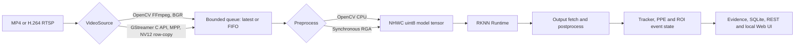

# RK-EdgeStation flagship optimization report

- **Report date:** 2026-11-07
- **Baseline:** `ab4fb7c96fc999ffb238f2aabfade29afd936154`
- **Target:** KICKPI K7 / Rockchip RK3576
**Status at the original report baseline:** GStreamer/MPP and RGA were integrated in the C++17 Worker and board-tested. The follow-up against baseline `ff0652724bb3b6fee1c40744cd2b3541bd325c2d` now adds a partial low-copy DMA-BUF input option and one dynamic construction-site video run. These follow-up results are documented in [ZERO_COPY_BENCHMARK_REPORT.md](ZERO_COPY_BENCHMARK_REPORT.md) and [DYNAMIC_VIDEO_EVALUATION.md](DYNAMIC_VIDEO_EVALUATION.md). The new clip still does not establish independent PPE/event accuracy.

## Findings

- The selectable production path is `OpenCV/FFmpeg or GStreamer/MPP -> bounded queue -> CPU or RGA preprocessing -> RKNN -> tracking/events -> SQLite/API/Web`. The old OpenCV/CPU reference remains available.
- At a media-clock 10-FPS input, MPP/RGA with the COCO FP model processed 7.981 FPS versus 7.656 FPS for OpenCV/CPU. Its decode-to-result P95 was 220.6 ms versus 236.6 ms, with lower measured process CPU and RSS. This is a modest system gain, not an acceleration multiplier.
- COCO INT8 reached 9.991 FPS on that 10-FPS input with no drops. It is a speed candidate only; its accuracy was not established on labels in this report.
- PPE YOLOX-S INT8 was converted from the same graph, calibrated with 50 class-aware training images, and run on RK3576. On the same 15-FPS positive replay it reached 7.975 FPS versus 4.593 FPS for MPP/RGA FP, reducing median dropped frames from 103 to 69. On the 200-image development validation split, AP50 changed 73.10% to 72.21%, AP50:95 changed 46.77% to 45.76%, `no_helmet` recall stayed at 59.78%, and `no_vest` recall changed 73.08% to 70.77%. The split was also used to select the FP checkpoint, so these are development comparisons, not independent test estimates.
- At this report's original baseline, MPP output was copied into owned packed NV12 memory and RGA wrote a CPU-addressable tensor passed to `rknn_inputs_set`. The follow-up adds Z2: MPP DMA-BUF → RGA → RKNN shared input allocation. It removes the explicit Worker NV12 row-copy, but does not establish full zero-copy or absence of internal driver/runtime movement.

## Board and software boundary

The board is Ubuntu 24.04.3 on aarch64 with Linux 6.1.75, eight CPU cores and 8 GiB RAM. The tested software was GStreamer 1.24.2, Rockchip MPP GStreamer plugin 1.14.4, RKNN Runtime 2.0.0b0 / driver 0.9.7, and the installed RGA interface. The hardware audit records Debian packages `librockchip-mpp1 1.5.0-1` and `librga2 2.2.0-1`; the development `pkg-config` files report MPP 1.3.9 and RGA 2.1.0. These package versus `.pc` version strings differ, so the report identifies the exact queried source rather than treating one string as a complete ABI guarantee. The existing board stack was used without a kernel, runtime, plugin, or package upgrade. See [hardware audit](evidence/p0/hardware-audit.txt).

`/dev/mpp_service` and `/dev/rga` were present. The RKNN C API worker and evaluator ran on the board, although `/dev/rknpu*` nodes were not visible. Reliable per-core NPU utilization was therefore unavailable. No physical camera was detected; RTSP tests used a file-backed H.264 source over a loopback-only test tunnel.

## Implemented path and ownership

Key source changes:

- [`src/video_source.hpp`](src/video_source.hpp) and [`src/video_source.cpp`](src/video_source.cpp) define a replaceable source interface. The GStreamer C API builds an H.264 MP4 `qtdemux` path or an H.264 RTSP `rtspsrc`/depay path through `mppvideodec`, negotiates NV12 at `appsink`, and maps/unmaps each `GstSample` with clear ownership. Visible Y and UV rows are copied using the negotiated plane strides; PTS is mapped through the segment for files. EOS, bus errors, timeouts, and teardown are handled. RTSP reconnect rebuilds the pipeline and increments `stream_epoch`.
- [`src/preprocess.hpp`](src/preprocess.hpp) and [`src/preprocess.cpp`](src/preprocess.cpp) keep CPU letterbox as a reference and add synchronous RGA resize/color/letterbox. The PPE contract stays BGR, NHWC `uint8`, raw 0–255; COCO stays RGB, NHWC `uint8`, raw 0–255.
- [`src/main.cpp`](src/main.cpp) now consumes `DecodedFrame` rather than a `cv::Mat` from `VideoCapture`, measures RKNN input submission separately from `rknn_run` and output fetch, and reports stage P50/P95, queue wait, decode-to-result age, drop counters, process CPU, RSS, source-copy bytes and model-input bytes.
- [`scripts/run_worker_ablation.py`](scripts/run_worker_ablation.py) runs interleaved, three-repeat board matrices and records per-run metrics, model/video/worker hashes, software versions and raw logs. `--model-family` explicitly selects the PPE postprocessor for PPE runs.
- [`tools/ppe_rknn_dataset_eval.cpp`](tools/ppe_rknn_dataset_eval.cpp), [`scripts/make_ppe_rknn_image_manifest.py`](scripts/make_ppe_rknn_image_manifest.py), and [`scripts/evaluate_ppe_rknn_predictions.py`](scripts/evaluate_ppe_rknn_predictions.py) perform board-side, full-image-set RKNN evaluation with the production CPU preprocessing and YOLOX postprocessor. This tool is for offline validation and is separate from the live Worker.

The GStreamer appsink is bounded to one sample and does not silently drop frames. The Worker queue remains the observable backpressure point: FIFO preserves pending order and drops a new frame when full; latest replaces the oldest pending frame. GStreamer mapping/copy releases the sample before inference. RGA runs synchronously on the consumer thread, so no RGA/NPU overlap on one frame is claimed. Source decoding can overlap consumer work through the producer thread and bounded queue.

## Experiment protocol and provenance

### COCO Worker matrix

- Same 150-frame H.264 clip for all rows: 768×576, nominal 10 FPS, SHA-256 `1ea4d10fac31c3b07be95117b3fc6e34e6f79daf9f3cddb3d25f7c4187e3ab98`.
- Same COCO model graph and worker build: FP SHA-256 `2162e0cf6a71270c092353d94abb391ac111910ce178547ef80dd89b225dab0b`; INT8 SHA-256 `18d1c195294b6590c24d931c6fe01d1032d9a07ee75df08c6c0023e6e777c2ac`; Worker SHA-256 `d24e5bd1cd09c547a65291e26ed950977199050ced44cc9e8ff5044b9ef8de3d`.
- Three interleaved repetitions per row. Offline uses no media pacing, FIFO capacity 151 to preserve all decoded frames. Media-clock uses 10-FPS pacing, latest capacity 1. Confidence threshold is 0.25.

### PPE Worker and quality matrix

- The Worker performance input is a 150-frame, 640×640, 15-FPS positive replay that repeats one validation image; video SHA-256 `a23d6d5c057f7c2eb52c79c883de1607d96b97f06eb645f06311b5f3bc6c439b`. Three repetitions were used for OpenCV/CPU FP, MPP/RGA FP, and MPP/RGA INT8.
- PPE FP RKNN SHA-256 `64cc93f556816286f17c9e21f69cd2f818c3602ef13dbb2d13ed48616f74482b`, 20,710,742 bytes. PPE INT8 SHA-256 `88b10ac2711f4b00d2859dfa0e1089ccb34ebd78a73b7dc46bd51a56c92c502c`, 11,566,602 bytes. The INT8 file is 44.2% smaller. ONNX SHA-256 is `27f99bea4cc115f8a5f45edb94230d408363ae3dd5dcff19745f5514d99ef711`.
- Toolkit2 2.0.0b0 converted the same YOLOX-S graph for RK3576 with BGR raw-pixel input settings (`mean=0`, `std=1`). The calibration set contains 50 deterministically selected images from the training split, with coverage of all 12 classes. Toolkit2 changed the input and all three output maps to INT8; board runtime attributes confirmed the quantized contract.
- FP and INT8 quality runs used all 200 images in the dataset's development validation split. The FP epoch had already been selected against this split, and there is no independent test split. AP uses 101-point interpolation over IoU 0.50–0.95; output collection used score floor 0.001 and NMS IoU 0.45. Class recall uses confidence 0.25 and IoU 0.50.

Raw run records, summaries and hashes are under [`evidence/flagship`](evidence/flagship/). Binary models, videos, datasets, prediction JSONL files, and tensor dumps remain in ignored `.work` storage and are not committed.

## End-to-end results

### A0–A3 unpaced offline matrix

Every row decoded and processed all 150 frames with zero drops. The large decode-to-result age is expected: unpaced decode filled the preserve-all FIFO queue faster than inference drained it. Do not read this backlog P95 as real-time latency.

| ID | Decode / preprocess / model | Median processed FPS (range) | Processed / dropped | Decode-to-result P50 / P95 | Process CPU, one-core / 8-core normalized | Peak RSS |
|---|---|---:|---:|---:|---:|---:|
| A0 | OpenCV/FFmpeg / CPU / FP | 8.105 (8.092–8.121) | 150 / 0 | 8,820 / 17,130 ms | 71.3% / 8.9% | 323,080 kB |
| A1 | MPP / CPU / FP | 7.928 (7.887–7.953) | 150 / 0 | 9,304 / 17,810 ms | 75.2% / 9.4% | 207,356 kB |
| A2 | MPP / RGA / FP | 8.226 (7.886–8.264) | 150 / 0 | 8,966 / 17,232 ms | 56.4% / 7.0% | 205,488 kB |
| A3 | MPP / RGA / INT8 | 13.903 (13.324–14.016) | 150 / 0 | 4,973 / 10,036 ms | 58.8% / 7.3% | 187,144 kB |

Median stage P50/P95 per processed frame:

| ID | Decode (ms) | Preprocess (ms) | RKNN input set (ms) | `rknn_run` (ms) | Output fetch (ms) | Postprocess (ms) |
|---|---:|---:|---:|---:|---:|---:|
| A0 | 3.185 / 4.682 | 7.166 / 19.369 | 41.674 / 49.614 | 59.507 / 60.712 | 11.912 / 16.596 | 1.649 / 2.507 |
| A1 | 1.040 / 2.556 | 9.000 / 34.941 | 40.529 / 49.914 | 59.597 / 61.805 | 11.963 / 17.745 | 1.632 / 2.354 |
| A2 | 0.995 / 2.419 | 3.089 / 3.441 | 43.952 / 49.362 | 59.663 / 60.650 | 13.082 / 17.184 | 1.638 / 2.436 |
| A3 | 1.013 / 2.622 | 4.116 / 5.085 | 1.291 / 1.535 | 40.353 / 46.967 | 7.376 / 7.531 | 16.363 / 22.154 |

### Media-clock 10-FPS matrix

Queue capacity is one with latest-frame policy. This input mode separates actual source-paced work from the offline throughput test.

| ID | Decode / preprocess / model | Median FPS (range) | Processed / dropped, median | Decode-to-result P50 / P95 | CPU one-core / system | Peak RSS |
|---|---|---:|---:|---:|---:|---:|
| R0 | OpenCV/FFmpeg / CPU / FP | 7.656 (7.581–7.821) | 116 / 34 | 175.247 / 236.595 ms | 94.1% / 11.8% | 139,008 kB |
| R2 | MPP / RGA / FP | 7.981 (7.956–8.081) | 120 / 30 | 175.071 / 220.603 ms | 61.1% / 7.6% | 110,648 kB |
| R3 | MPP / RGA / INT8 | 9.991 (9.990–9.991) | 150 / 0 | 78.008 / 106.333 ms | 47.5% / 5.9% | 89,980 kB |

MPP/RGA FP improved median throughput by 4.2% over OpenCV/CPU FP and lowered P95 by 16.0 ms, while using about 35% less one-core CPU and 20% less peak RSS. COCO INT8 kept pace with the 10-FPS source in all three runs. These are measurements on one moving sample clip, not a camera or multi-stream guarantee.

### Latest versus FIFO under the same 10-FPS MPP/RGA FP load

| Policy | Median FPS | Processed / dropped, median | Decode-to-result P50 / P95 |
|---|---:|---:|---:|
| Latest | 8.109 | 122 / 28 | 172.953 / 221.743 ms |
| FIFO | 8.200 | 124 / 26 | 189.357 / 249.480 ms |

Latest processed two fewer frames at the median but had 27.7 ms lower P95 age. The result supports latest for freshness under overload; FIFO is still available when preserving the order of queued frames matters.

### PPE FP and INT8 worker comparison at 15-FPS input

| ID | Decode / preprocess / model | Median FPS | Processed / dropped, median | Decode-to-result P95 | RKNN input / run / fetch / post P50 | Peak RSS |
|---|---|---:|---:|---:|---:|---:|
| R0 | OpenCV/FFmpeg / CPU / FP | 4.601 | 47 / 103 | 295.875 ms | 49.214 / 154.091 / 2.969 / 3.909 ms | 156,104 kB |
| R2 | MPP / RGA / FP | 4.593 | 47 / 103 | 290.036 ms | 49.855 / 143.680 / 3.064 / 4.663 ms | 124,152 kB |
| R3 | MPP / RGA / INT8 | 7.975 | 81 / 69 | 189.413 ms | 0.858 / 115.882 / 0.344 / 2.351 ms | 111,116 kB |

PPE RGA did not raise FP throughput on this 640×640 source; it is already the model input size, so its resize/color operation adds work. MPP/RGA lowered CPU and RSS. PPE INT8 raised worker throughput 73.6% versus MPP/RGA FP and lowered P95 by 100.6 ms. Each INT8 run emitted one PPE violation in the repeated positive replay, which checks the Worker event route but not temporal event accuracy.

## PPE validation-set quality comparison

| Metric | YOLOX-S FP RKNN | Same-graph INT8 RKNN | INT8 change |
|---|---:|---:|---:|
| AP50 | 73.10% | 72.21% | −0.89 percentage points |
| AP50:95 | 46.77% | 45.76% | −1.00 percentage points |
| `no_helmet` recall, confidence ≥0.25 / IoU ≥0.50 | 59.78% (107/179) | 59.78% (107/179) | 0.00 pp |
| `no_vest` recall, confidence ≥0.25 / IoU ≥0.50 | 73.08% (95/130) | 70.77% (92/130) | −2.31 pp |

This is a useful same-split quantization comparison with actual board RKNN outputs. Because this validation set selected the FP checkpoint, it does not establish generalization. The recall reduction for `no_vest` is small but safety-relevant; retain PPE FP as the default until separately recorded dynamic footage and temporal event labels validate the candidate.

## Tensor and detection consistency

| Comparison | Input result | Output/detection result | Boundary |
|---|---|---|---|
| COCO FP MPP/CPU vs MPP/RGA | 1,228,800 B; 70.27% exact, mean byte difference 0.311, max 7 | 5/5 same-class matches at IoU≥0.5; mean IoU 0.9733; mean confidence delta 0.00195 | One source frame; preprocessing comparison |
| COCO FP vs INT8 with same MPP/RGA input | Input tensor byte-identical | 5/5 same-class matches; mean IoU 0.9538; mean confidence delta 0.0163 | One source frame; not accuracy |
| PPE FP MPP/CPU vs MPP/RGA | 1,228,800 B; mean byte difference 0.370, max 13 | 11/11 matches; mean IoU 0.9971; output-map cosine similarity >0.99977 | One source frame; PPE contract stays BGR raw 0–255 |
| PPE FP vs INT8 with same MPP/RGA input | Input tensor byte-identical | 11/11 matches; mean IoU 0.9550; mean confidence delta 0.0242; output-map cosine 0.9961–0.9994 | One source frame; full-set AP/recall is reported separately above |

The RGB/BGR order and raw range were held fixed. COCO and PPE tensor-dump summaries and tensor SHA-256 records are under [`evidence/flagship`](evidence/flagship/); raw binary tensors remain ignored in `.work`.

## Decoder, business flow and RTSP evidence

On the same 150-frame H.264 clip, the stage probe measured MPP-to-NV12 fakesink median 1,549.9 FPS, MPP plus BGR conversion 151.5 FPS, and OpenCV/FFmpeg BGR 479.3 FPS. NV12-to-fakesink stops before model preprocessing and inference, so it is not Worker throughput. MPP was useful when its NV12 frame fed RGA directly; MPP-to-BGR was slower than the software baseline. The Worker matrices above are the relevant end-to-end comparison.

The existing PPE service flow was exercised with MPP/RGA FP on the positive and compliant fixed-scene clips: health, metrics and event-history APIs returned HTTP 200, SQLite was available, event-write failures were zero, the positive replay emitted its PPE violation, and the compliant replay counted the correctly equipped person. The archived API evidence is [here](evidence/ppe/rk3576-ppe-api-smoke.json). PPE INT8 Worker runs also emitted one violation on the positive repeated-scene clip. ROI entry/leave/dwell, danger-zone intrusion, de-duplication, cooldown, evidence image, SQLite persistence and local Web/API behavior remain part of the existing application. Forklift/person co-occurrence is an image-region cue, not physical distance or collision prevention.

The H.264 RTSP reconnect test used a file-backed local server and a loopback-only reverse tunnel. After an intentional server stop, the GStreamer/MPP worker logged RTSP errors, rebuilt the source, advanced epochs through 9, reset stream state, and ended connected: 1,376 decoded, 1,034 processed, 342 queue drops, 13 reconnect attempts, zero appsink/backend drops. The repeated file EOS epochs make these recovery counts unsuitable as a throughput result. See [`rtsp-reconnect-summary.json`](evidence/flagship/rtsp-reconnect-summary.json) and the filtered [reconnect log](evidence/flagship/rtsp-reconnect.log). No physical camera or customer RTSP network was tested.

## Bottleneck analysis and configuration decision

- **COCO FP:** RKNN input submission (about 42–44 ms P50), `rknn_run` (about 60 ms), and output fetch (about 12–13 ms) dominate the pipeline. CPU letterbox is about 7.2 ms; RGA reduces it to about 3.1 ms on this 768×576 source, but overall FP throughput changes little. A1 MPP plus CPU reached 7.928 FPS, below A0's 8.105 FPS, because the NV12-to-BGR CPU path adds work.
- **COCO INT8:** input submission fell from about 42 ms to 1.3 ms, `rknn_run` from about 60 ms to 40 ms, and output fetch from about 12 ms to 7.4 ms. Quantized output decoding raised CPU postprocess from about 1.6 ms to 16.4 ms, so that stage is now material. Even with the cost, throughput rose to 13.903 FPS offline and kept pace with the 10-FPS source.
- **PPE FP:** input submission was about 50 ms and `rknn_run` about 144 ms with MPP/RGA. This is the main reason the 15-FPS input drops frames. RGA does not help this already-square source.
- **PPE INT8:** input submission fell below 1 ms, `rknn_run` to about 116 ms, output fetch below 1 ms, and postprocess was about 2.4 ms. The performance gain is paired with the measured validation-set changes above; it is not accepted as safety-equivalent without dynamic validation.
- **MPP/RGA:** In the original baseline, copying padded NV12 rows into owned memory blocked direct DMA-BUF sharing. The follow-up proves the installed MPP FD can be imported by RGA and that RGA can write into an RKNN-owned input FD. This partial low-copy path reduced explicit copies and CPU/RSS in matched tests, but made only a small throughput difference; see the follow-up benchmark for its limits.
- **Queue:** Latest and FIFO produced similar throughput on the 10-FPS overload clip. Latest delivered a fresher result by P95 and is the appropriate real-time default; FIFO is retained for ordered/replay work.

Recommended deployment profiles for the current evidence:

1. Keep OpenCV/CPU plus FP as the correctness/reference fallback and the default for unreviewed models.
2. Use MPP/RGA plus latest for the RK3576 demo when CPU/RSS headroom matters; it has a small COCO FP throughput gain and lower process CPU/RSS, but it is not a universal FPS upgrade.
3. Keep PPE YOLOX-S FP as the safety-oriented default. Expose PPE INT8 as an experimental candidate for controlled evaluation: it is 44.2% smaller and materially faster, while losing 2.31 pp `no_vest` recall on the development split.
4. Keep the later Z2 DMA-BUF/shared-input route optional. It removes one explicit 1.3824 MB/frame CPU copy and modestly reduces CPU/RSS, but does not justify replacing stable Z0 as the default.

## Reproduction and evidence

The Worker matrix can be rerun on RK3576 with [`scripts/run_worker_ablation.py`](scripts/run_worker_ablation.py), the same board binary, media and model hashes, and `--experiment offline`, `media-clock`, or `realtime-queue`. PPE runs require `--model-family yolox-ppe`. The board quality evaluator is built with `cmake --build build --target ppe_rknn_dataset_eval`; generate an ordered COCO image manifest with `scripts/make_ppe_rknn_image_manifest.py`, run the board evaluator once per model, then calculate metrics with `scripts/evaluate_ppe_rknn_predictions.py`.

The raw records and evidence files include:

- [`offline-final`](evidence/flagship/offline-final/summary.json), [`media-clock-final`](evidence/flagship/media-clock-final/summary.json), and [`realtime-queue-final`](evidence/flagship/realtime-queue-final/summary.json), each with per-run JSON, worker hash, stage metrics and software metadata.
- [`ppe-int8`](evidence/flagship/ppe-int8/) with the 9-run worker matrix, calibration selection, board FP/INT8 AP/recall, model hashes and dataset/evaluator provenance.
- [`ppe-cpu-vs-rga.json`](evidence/flagship/ppe-cpu-vs-rga.json), [`ppe-fp-vs-int8.json`](evidence/flagship/ppe-fp-vs-int8.json), COCO tensor comparisons, and tensor-dump SHA records.
- [`flagship-ablation.png`](evidence/flagship/flagship-ablation.png) and its editable SVG source.
- [`rk3576-build-test.txt`](evidence/flagship/rk3576-build-test.txt) and the existing [PPE API smoke](evidence/ppe/rk3576-ppe-api-smoke.json).

## Interview-ready contributions

1. Integrated a selectable C++17 GStreamer/MPP NV12 input path and synchronous RGA preprocessing into an existing RKNN industrial-safety Worker, with stride-aware buffer ownership, PTS, bounded queues and RTSP epoch recovery.
2. Built matched RK3576 end-to-end ablations that separate unpaced throughput from media-clock latency and record per-stage timing, drops, CPU, RSS, model/video/worker hashes and tensor/detection consistency.
3. Converted and measured a same-graph PPE YOLOX-S INT8 candidate on RK3576, quantifying its model-size, throughput, AP and critical-class recall tradeoff on the available development validation split.

## Acceptance boundary

The core heterogeneous path, low-copy candidate, performance measurements, model candidate and existing service/event wiring are implemented and board-tested. This remains a substantial edge-inference engineering portfolio result, but it does **not satisfy full independent industrial-safety validation**: only one short dynamic construction video was reviewed; it contains no confirmed PPE violation or forklift; three of four final-run PPE alerts were visually inconsistent with the visible clothing and one helmet result was unknown; no physical camera was attached; the PPE validation split participated in model selection; and NPU utilization telemetry is unavailable. Static or qualitative event exercises do not replace those missing checks.
