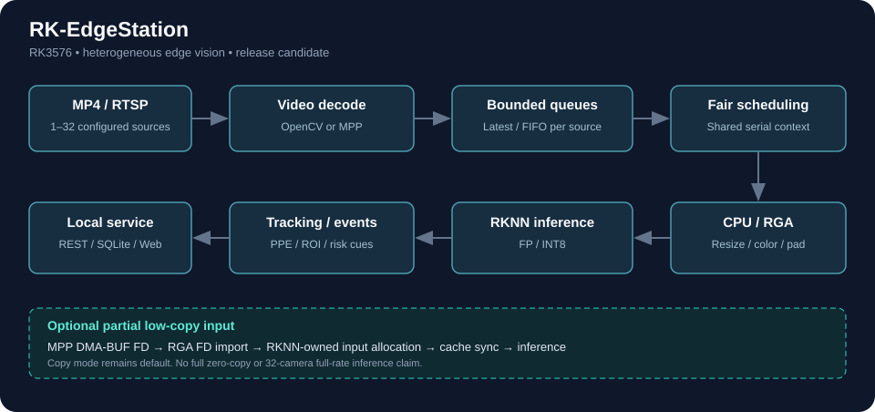
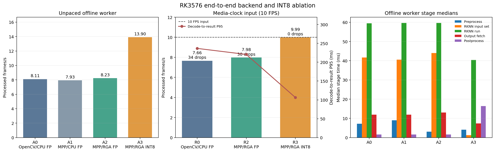

# RK-EdgeStation

**Hardware-accelerated industrial edge vision on Rockchip RK3576**

[简体中文](README_CN.md) · [Quick start](docs/quickstart.md) · [Architecture](docs/architecture.md) · [Benchmarks](benchmarks/README.md) · [Release checklist](docs/release-checklist.md)

RK-EdgeStation is a C++17/Python edge-vision platform combining hardware video decoding, RGA preprocessing, RKNN inference, bounded scheduling and local industrial event management on a single Rockchip board. The release candidate is validated against KICKPI K7 / RK3576, not all Rockchip SoCs.



## Features

- MP4 and H.264 RTSP ingest, selectable OpenCV/FFmpeg and GStreamer/MPP backends.
- CPU or RGA letterbox/color conversion; optional DMA-BUF-to-RKNN shared-input path.
- RKNN FP and INT8 model experiments with stage profiling, accuracy evaluation and reproducible benchmark records.
- Bounded Latest/FIFO queues, per-camera capture/reconnect and weighted fair multistream scheduling.
- Object tracking, PPE association, ROI entry/leave/dwell and image-space person/forklift risk cues.
- Local REST API, web dashboard, SQLite event history, evidence images and user-level systemd recovery.

## Board results

These are historical measured results from the cited configurations, not new release-candidate runs.

| Experiment | Result | Scope |
| --- | --- | --- |
| COCO FP vs INT8 pipeline | 7.656 → 9.991 FPS; P95 236.6 → 106.3 ms | Single 10-FPS H.264 input; CPU/FP vs MPP/RGA/INT8 |
| YOLOX-S PPE FP vs INT8 | 4.593 → 7.975 FPS; AP50:95 46.77% → 45.76% | Repeated-image 15-FPS video; AP on 200 development-validation images |
| DMA-BUF shared input | 1,382,400 → 0 explicit ingress copy bytes/frame; 7.937 → 8.046 FPS | 720p moving video, PPE INT8, three media-clock runs |
| Multistream scheduling | 32/32 synthetic RTSP mounts connected; 4.09 aggregate FPS; 95.14% drops | One shared serialized FP model, short 32-source test, not real-time 32-camera detection |

[Detailed results and raw evidence](benchmarks/README.md)



## Quick start

Verified target: KICKPI K7, RK3576, Ubuntu 24.04.3 aarch64, vendor Linux 6.1.75, RKNN Runtime 2.0.0b0, OpenCV 4.6, GStreamer 1.24, MPP and RGA.

On the board, with compatible development headers and runtime installed:

```bash
cmake -S . -B build -DCMAKE_BUILD_TYPE=Release -DBUILD_TESTING=ON
cmake --build build --parallel 4
ctest --test-dir build --output-on-failure
```

Supply your own compatible, appropriately licensed RKNN model and video:

```bash
bash scripts/run_demo.sh /path/to/model.rknn /path/to/input.mp4
```

Open the board's local dashboard at http://127.0.0.1:8080. See [quick start](docs/quickstart.md) for model families, RTSP, remote viewing, multistream and host-only tests. Models, source videos and vendor SDK binaries are not bundled.

## Project layout

| Location | Purpose |
| --- | --- |
| `src/` | C++ worker, video, preprocessing, tracking, event logic, multistream scheduler |
| `python/edge_station/`, `web/` | Local service, storage and dashboard |
| `deploy/`, `scripts/`, `tools/` | Example configuration, deployment and experiment utilities |
| `tests/`, `training/`, `model/` | Tests, training configuration and labels |
| `docs/`, `benchmarks/` | Current documentation and benchmark index |
| `evidence/` | Historical experimental records, including explicitly excluded runs |

[Full documentation index](docs/README.md)

## Scope and limitations

- Partial low-copy only: internal driver/runtime transfers are unobservable. Copy mode remains the default; unsupported DMA-BUF layouts require the copy path.
- Thirty-two synthetic RTSP mounts are a connection/scheduling result, not a throughput or production-capacity claim.
- PPE results are development or small-sample experiments. Independent event accuracy, physical-camera behavior, reliable NPU utilization and long-duration production stability are not established.
- Fire/smoke is not ready; no safety-rated or certified alarm behavior is claimed. Image-space risk is not physical distance.
- The service is local-only by default. Do not expose it directly to untrusted networks.

## License

Project source is Apache-2.0; see [LICENSE](LICENSE) and [third-party notices](THIRD_PARTY_NOTICES.md). Model weights, datasets, videos and vendor runtime components have separate terms. No commercial suitability or redistribution rights for external assets are implied.

Status: **v0.1.0 experimental source release**. Historical board evidence is retained; fresh board acceptance and demonstration are optional. See [release checklist](docs/release-checklist.md).
