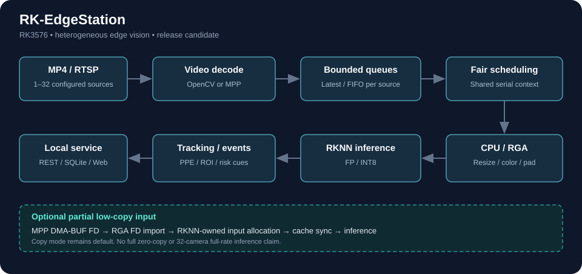
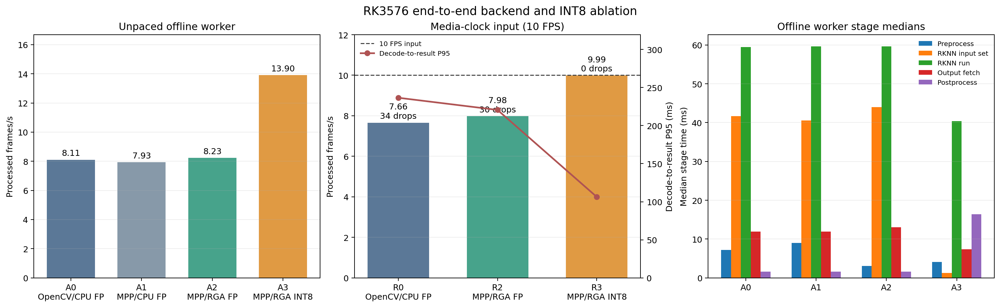

# RK-EdgeStation

**面向 Rockchip RK3576 的硬件加速工业边缘视觉平台**

C++17 · GStreamer/MPP · RGA · RKNN · DMA-BUF · Python · SQLite

[English](README.md) · [快速部署](docs/quickstart.md) · [系统架构](docs/architecture.md) · [性能实验](benchmarks/README.md)

RK-EdgeStation 是运行于单块 RK3576 上的端侧工业视觉推理引擎，将视频流接入、硬件解码、图像预处理、NPU 推理、目标跟踪和时序事件分析整合为一套完整的异构计算系统，实现从摄像头输入到工业告警与本地管理的业务闭环。



## 核心技术

| 技术方向 | 实现内容 |
| --- | --- |
| **异构计算流水线** | GStreamer/MPP 硬件解码，RGA 图像缩放、颜色转换和 Letterbox，RKNN C API NPU 推理。 |
| **DMA-BUF 共享内存** | MPP 解码缓冲区生命周期管理、RGA FD 导入、RKNN 输入内存绑定及 Cache 同步，消除应用层 NV12 输入拷贝。 |
| **模型部署与推理优化** | FP/INT8 模型转换、张量契约校验、推理输出一致性测试、精度与性能权衡、分阶段性能剖析。 |
| **C++17 实时调度** | 生产者消费者模型、有界队列、Latest/FIFO 策略、背压控制、独立视频源状态及加权公平调度。 |
| **工业视觉事件引擎** | 目标跟踪、PPE 人员关联、ROI 区域进入/离开/停留、多帧确认、告警冷却与事件证据。 |
| **端侧应用工程** | Python REST API、Web 管理界面、SQLite 持久化、RTSP 断流重连与 systemd 服务恢复。 |

## RK3576 板端性能

| 优化指标 | 优化前 → 优化后 |
| --- | ---: |
| COCO 单路推理吞吐（10 FPS 输入） | **7.66 → 9.99 FPS** |
| COCO 解码到结果 P95 | **236.6 → 106.3 ms** |
| COCO 进程 CPU 占用（单核口径） | **94.1% → 47.5%** |
| YOLOX-S PPE FP → INT8 推理吞吐 | **4.59 → 7.98 FPS** |
| YOLOX-S PPE 模型大小 | **20.71 → 11.57 MB** |
| DMA-BUF 每帧显式 NV12 输入拷贝 | **1.38 MB → 0 B** |
| DMA-BUF 预处理 P50 | **3.65 → 2.72 ms** |



实验平台为 KICKPI K7 / RK3576，分别采用 COCO CPU/FP 与 MPP/RGA/INT8 对比、同图结构 YOLOX-S PPE FP/INT8 对比，以及 720p 动态视频 DMA-BUF 共享输入实验。PPE 开发验证集 AP50:95 为 46.77% → 45.76%。完整实验条件、原始记录及精度分析见 [性能实验索引](benchmarks/README.md)。

## 快速运行

在已配置 RKNN Runtime、OpenCV、GStreamer、MPP 和 RGA 开发库的 RK3576 板端执行：

```bash
git clone https://github.com/Ustinian1722/RK-EdgeStation.git
cd RK-EdgeStation
cmake -S . -B build -DCMAKE_BUILD_TYPE=Release
cmake --build build --parallel 4
bash scripts/run_demo.sh /path/to/coco.rknn /path/to/input.mp4
```

访问本地管理页面 **http://127.0.0.1:8080**。模型及厂商运行时需独立准备，PPE 模型、RTSP 和 DMA-BUF 运行方式见 [快速部署](docs/quickstart.md)。

## 源码导航

| 模块 | 源码入口 |
| --- | --- |
| 视频接入与缓冲区生命周期 | [video_source.cpp](src/video_source.cpp) |
| RGA 预处理与 RKNN 推理 | [preprocess.cpp](src/preprocess.cpp)、[main.cpp](src/main.cpp) |
| 线程调度与有界队列 | [bounded_queue.hpp](src/bounded_queue.hpp)、[multistream.cpp](src/multistream.cpp) |
| 跟踪与工业事件 | [tracker.cpp](src/tracker.cpp)、[ppe_events.cpp](src/ppe_events.cpp)、[roi_events.cpp](src/roi_events.cpp) |
| 本地管理服务 | [server.py](python/edge_station/server.py)、[storage.py](python/edge_station/storage.py)、[Web](web/) |
| 测试与复现工具 | [tests](tests/)、[scripts](scripts/)、[文档索引](docs/README.md) |

## 开源许可

项目源码采用 Apache-2.0。外部模型、数据与运行时遵循各自的许可证，详见 [第三方声明](THIRD_PARTY_NOTICES.md)。
