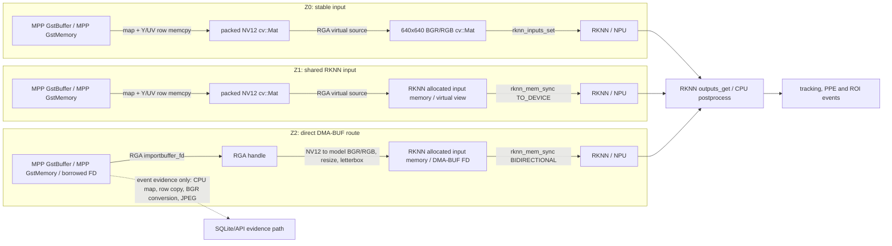

# RK3576 DMA-BUF feasibility audit

- **Source baseline:** `ff0652724bb3b6fee1c40744cd2b3541bd325c2d`
- **Device:** KICKPI K7 / RK3576, Ubuntu 24.04.3, Linux 6.1.75, RKNN Runtime 2.0.0b0
- **Audit result:** the board supplies an MPP-allocator GstMemory with a valid DMA-BUF FD under ordinary NV12 caps; librga imports that FD and the Worker successfully runs RGA directly into an RKNN-owned input FD. The accepted route removes the Worker's explicit source NV12 row-copy and model-input staging allocation. It does **not** establish that the RKNN runtime or kernel performs no internal data movement.
- **Production default:** Z0 remains default. DMA-BUF/shared input is an explicit experimental option because measured throughput gain was small and P95 did not improve.

## Actual Worker paths

The OpenCV/FFmpeg + CPU preprocessing path remains available as the host-side image baseline. Event evidence deliberately maps the retained GstSample and produces CPU BGR/JPEG data only when an event is emitted.

## Observed memory and copy inventory

| Stage | Observed layout/bytes | Ownership and synchronisation | Finding |
|---|---|---|---|
| MPP → GStreamer | 1280×720 NV12; one `GstMemory`, allocator type `mpp`; current GstMemory size 1,589,760 B; allocator maxsize and `fstat(fd)` size 2,121,728 B; `GstVideoMeta` Y/UV stride 1472, UV offset 1,059,840, memory offset 0. FD is borrowed from the retained GstSample. | `DecodedFrame` holds a shared GstSample reference through queued-frame drops, RGA completion and result processing. It never closes the borrowed FD. A 10-cycle open/close probe confirmed the FD stays valid while a frame retains the sample and closes after that frame releases it. | Actual caps are ordinary `video/x-raw,format=NV12`; `caps_dmabuf=false`, no `drm-format`/modifier field. Yet every sampled `GstMemory` was allocator `mpp`, DMA-BUF-backed, and had a valid FD. Requesting `memory:DMABuf` caps failed negotiation, so the implementation relies on observed allocator/memory metadata, not caps feature negotiation. |
| GStreamer CPU map in Z0/Z1 | Visible packed NV12 is 1280×1080 bytes = 1,382,400 B/frame. | `gst_video_frame_map(READ)`, Y rows then UV rows copied using the observed per-plane strides; sample is unreffed after copying. Mapping may perform cache work or migration that is not externally visible. | Exactly one explicit full-frame source pixel copy in Worker accounting. At 120 decoded frames this is 165,888,000 B; at 510 decoded frames it is 705,024,000 B. |
| Z2 source retention | No packed NV12 `cv::Mat` is created for inference; `source_copy_bytes_total=0`. RGA imports the MPP FD using the allocator maxsize. | The shared GstSample bounds source lifetime. RGA uses `IM_SYNC`; imported RGA handles are released before the source sample can be dropped. | Eliminates the Worker's visible-plane CPU row-copy. It does not prove that `gst_memory_get_sizes`, MPP, the DMA heap, IOMMU, RGA or cache-coherency layer performs no hidden copy/migration. |
| RGA source/destination in Z0 | RGA wraps owned NV12 virtual-address source; writes to a new 640×640×3 `CV_8UC3` output, 1,228,800 B. | Synchronous RGA operation; ordinary CPU-addressable OpenCV allocations. | No explicit CPU pixel copy is performed by the Worker at this call. RGA may still map/flush virtual memory internally. |
| RGA source/destination in Z1 | Same packed NV12 source; RGA writes to an OpenCV view of `rknn_create_mem` storage. | `rknn_create_mem` allocation and `rknn_set_io_mem` binding; then `rknn_mem_sync(TO_DEVICE)` for RGA virtual-address output, as the caller also accesses that allocation through its CPU virtual mapping. | Removes the separate model-input allocation/copy between RGA and RKNN. Z1 still has the MPP→packed-NV12 CPU copy. |
| RGA source/destination in Z2 | MPP NV12 DMA-BUF FD → RGA imported handle → RGA imported RKNN-input FD. Destination payload 1,228,800 B. RGA writes BGR for PPE or RGB for COCO according to the existing model contract. | Two imported handles are used together; both are released after synchronous `improcess`. Before NPU inference, the Worker calls `rknn_mem_sync(BIDIRECTIONAL)` on the externally written shared input. The installed Runtime header defines this as both directions of CPU/device cache consistency. | The production dual-FD operation succeeded on RK3576. A separate exploratory RGA-handle→virtual-address `imcopy` failed with the driver message “only handles or no handles”; that mixed-memory probe was not treated as proof the MPP FD itself is incompatible. |
| RKNN shared input | PPE INT8: native NHWC `[1,640,640,3]`, UINT8 write contract, `size_with_stride=1,228,800` B. FP model: native input reports a 2,457,600 B stride allocation; the established raw UINT8 image contract was preserved. | RKNN-owned `rknn_tensor_mem`, valid FD and virtual address, bound once by `rknn_set_io_mem`; one inference at a time avoids reuse races. Runtime-managed tensor memory is destroyed before context teardown. | `rknn_inputs_set` is skipped in shared mode. Runtime conversion or internal copy behavior is not observable from this API and is not claimed to be absent. |
| RKNN outputs | PPE exposes three outputs. Worker continues using `rknn_outputs_get`/release and CPU postprocessing. | Runtime-owned output pointers are read before release. | NPU-to-CPU output copying/cache work is not exposed by this instrumentation and remains present as a CPU-visible processing boundary. |
| Event evidence | Only on emitted events: retained GstSample is mapped; visible Y/UV rows are copied to packed NV12, converted to BGR, cloned/annotated, then JPEG-encoded. | GstSample reference remains held until this work completes; standard GStreamer map/unmap and OpenCV ownership are used. | `source_copy_bytes_total=0` counts only the inference ingress path. It does not count event evidence maps/copies or any internal driver/runtime movement. |

The GstVideoMeta values describe the currently observed sample. Actual caps do not report a DRM modifier; the Worker accepts only one MPP DMA-BUF with offset 0 and two contiguous, equal-stride NV12 planes. RGA operation and tensor parity establish that this exact board sample layout is usable on this board. Other plugin versions, formats, modifiers and multi-memory buffers are rejected rather than guessed. GStreamer documents that caps features and DRM format/modifier are part of DMA-BUF negotiation, and that plane metadata alone must not be treated as sufficient for an unknown non-linear layout ([DMA-BUF design](https://gstreamer.freedesktop.org/documentation/additional/design/dmabuf.html)).

## Board API compatibility and probes

- GStreamer 1.24.2; Rockchip `mppvideodec` plugin 1.14.4. With default ordinary NV12 caps, 510/510 frames in the EOS probe exposed one MPP GstMemory with a valid DMA-BUF FD. The plugin's `dma-feature` property was false. `memory:DMABuf` caps request did not negotiate.
- The probe's parseable records are [`gst-eos-fd-probe.jsonl`](evidence/dynamic-video/gst-eos-fd-probe.jsonl); its full stdout, including the intentionally failing mixed-handle RGA diagnostic, is retained in [`gst-eos-fd-probe.raw.log`](evidence/dynamic-video/gst-eos-fd-probe.raw.log). Ten-cycle ownership data is in [`lifecycle-10.jsonl`](evidence/dynamic-video/lifecycle-10.jsonl).
- RKNN Runtime 2.0.0b0 exports and successfully executes `rknn_create_mem`, `rknn_set_io_mem`, `rknn_mem_sync`, and the existing `rknn_inputs_set`/output APIs. The installed header defines TO_DEVICE for device consistency after CPU writes, FROM_DEVICE for CPU consistency after device writes, and BIDIRECTIONAL for both directions. The Worker uses TO_DEVICE for Z1's CPU-addressed output and BIDIRECTIONAL for Z2's external RGA writer before NPU consumption. Both paths passed board output parity; all API return codes are checked. Rockchip's Model Zoo uses the same native image-input attribute, UINT8 contract, `rknn_create_mem` and `rknn_set_io_mem` pattern ([Model Zoo zero-copy example](https://github.com/airockchip/rknn_model_zoo/blob/main/examples/yolov8/cpp/rknpu2/yolov8_zero_copy.cc)).
- librga API 1.10.1 imports both MPP and RKNN input FDs in the board Worker. `importbuffer_fd`, `wrapbuffer_handle`, and `releasebuffer_handle` are checked. Single-frame output/input parity passed for PPE FP and INT8 candidates; INT8's three output tensors and final detections were byte/exact-equal for repeated comparison of one captured frame.
- The 10-cycle source lifecycle probe held each GstSample through `VideoSource::close()`, verified its DMA-BUF FD remained valid while the frame retained it, then verified that FD closed after frame release. Open FD count rose from 3 to 8 on first MPP initialisation and remained at 8 for all later cycles; this is five process-global MPP/system-heap descriptors, not per-cycle growth. They close with process exit. This test covers repeated MP4 source open/close, not a physical camera or a live RTSP server.
- `/dev/mpp_service`, `/dev/rga` and `/dev/dma_heap/system` exist. `rgavideoconvert` is absent and was not installed. No system SDK/runtime/kernel/driver was replaced.

## Upstream implementation reference review

- [Yuyunzi/RK3576_MPP](https://github.com/Yuyunzi/RK3576_MPP) documents MPP Mode 3 with externally allocated buffers, an external buffer group after `info_change`, and decoder frame ownership. Its current README also reports that RGA DMA-BUF import from the author's `dma_heap` allocation fails on their RK3576 kernel and recommends using the MPP buffer virtual address. That is allocator/kernel-specific and did not describe this board's observed path: GStreamer exported an MPP-allocator FD, and this Worker successfully imported it with RGA. Because GStreamer already exposes a suitable FD, we did not rewrite video ingest around native MPP Mode 3 or change allocators.
- [ruisv/rcdl](https://github.com/ruisv/rcdl) shows a C++17 MPP → RGA → RKNN architecture and documents writing RGA output directly into RKNN's bound input tensor, but its install notes state RK3576/RK356x are not yet verified. It also bundles a newer `librknnrt` 2.3.2 than this board's pinned Runtime 2.0.0b0. We used it as design reference only and did not install it or replace system libraries.
- [corenel/gstreamer-rga](https://github.com/corenel/gstreamer-rga) advertises DMA-BUF pass-through when upstream allocators supply FDs and lists GStreamer 1.16 and librga 2.2.0+ as requirements. The plugin is absent on the target and was not built against its installed GStreamer/MPP/RGA ABI; compatibility remains unverified. Since the existing C++ Worker already imports the FD with librga, adding a custom GStreamer conversion element was unnecessary for this experiment.
- [Rockchip librga developer guide](https://github.com/airockchip/librga/blob/main/docs/Rockchip_Developer_Guide_RGA_EN.md) documents `importbuffer_fd`, `wrapbuffer_handle`, and `releasebuffer_handle`. Those functions are present in the board library. The Worker uses them for both source and destination, supplies the observed strides/formats, checks handles/status, and retains backing memory through synchronous RGA completion.
- [Rockchip RKNN Model Zoo's YOLOv8 shared-input example](https://github.com/airockchip/rknn_model_zoo/blob/main/examples/yolov8/cpp/rknpu2/yolov8_zero_copy.cc) queries native input attributes, sets the image input type to UINT8, allocates `size_with_stride` with `rknn_create_mem`, and binds with `rknn_set_io_mem`. The Worker follows the same allocation/binding pattern with its existing model-specific input contract; current Runtime exports and executes these APIs on RK3576.
- [GStreamer DMA-BUF design](https://gstreamer.freedesktop.org/documentation/additional/design/dmabuf.html) treats FD storage as `GstMemory` inside `GstBuffer`, and describes caps features, DRM format/modifier, and `GstVideoMeta` stride/offset as part of interpreting a frame. The target plugin negotiated ordinary NV12 caps without a modifier, so this implementation accepts only the tested contiguous MPP allocator layout; it does not infer unknown tiled/compressed layouts from a valid FD alone.

## Feasibility decision

| Candidate | Result on this RK3576 | Decision |
|---|---|---|
| RKNN shared input, RGA virtual-address output (Z1) | FP/INT8 single-frame tensors and detections match Z0; Worker builds and runs. | Keep as a supported experimental input mode. It does not remove the MPP row-copy and does not improve throughput enough to be default. |
| MPP GstMemory DMA-BUF → RGA → RKNN input DMA-BUF (Z2) | Real MPP FD, metadata, RGA import and synchronous two-handle operation work in the Worker; PPE INT8 input/output parity passed. Full dynamic video Worker completed without error. | Keep optional. Removes one explicit 1.3824 MB/frame CPU source copy. It is a **partial low-copy path**, not full zero-copy. |
| MPP Mode 3 / external allocator rewrite | Not needed: the installed GStreamer MPP path already supplies an FD accepted by RGA and RKNN memory. | Stop this branch; no MPP API rewrite or external pool migration. |

See [ZERO_COPY_IMPLEMENTATION.md](ZERO_COPY_IMPLEMENTATION.md) for lifetime, synchronization and fallback details and [ZERO_COPY_BENCHMARK_REPORT.md](ZERO_COPY_BENCHMARK_REPORT.md) for measured performance and recommendation.
