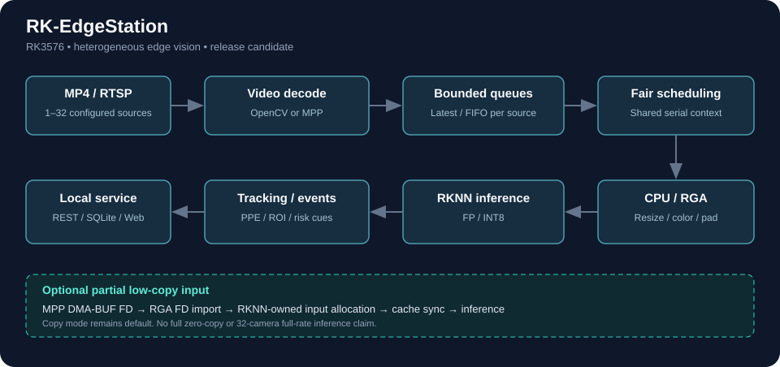

# Current release-candidate architecture

## Components

| Component | Source | Responsibility |
| --- | --- | --- |
| Ingest | [video_source](../src/video_source.cpp) | OpenCV/FFmpeg or GStreamer/MPP; ownership, timestamps, reconnect epochs |
| Scheduling | [bounded_queue](../src/bounded_queue.hpp), [multistream](../src/multistream.cpp) | Per-camera queue, Latest/FIFO, weighted fair selection |
| Worker | [main](../src/main.cpp) | RKNN context, inference, profiling, per-camera event state |
| Preprocess | [preprocess](../src/preprocess.cpp) | CPU/RGA resize, color conversion, letterbox, optional FD imports |
| Event logic | [tracker](../src/tracker.cpp), [PPE](../src/ppe_events.cpp), [ROI](../src/roi_events.cpp) | Tracks and temporal event rules |
| Management | [server](../python/edge_station/server.py), [storage](../python/edge_station/storage.py), [dashboard](../web/index.html) | Local API, SQLite, configuration and event browsing |

## Memory paths

- Z0 default: mapped NV12 rows copied to owned CPU storage; RGA writes a CPU-addressed model tensor; RKNN API submits input.
- Z1 optional: mapped NV12 copy retained; RGA writes into RKNN-owned input allocation, followed by synchronization.
- Z2 experimental: retained MPP GstSample and borrowed DMA-BUF FD; synchronous RGA imports both MPP and RKNN FDs; RKNN bidirectional memory sync before inference. Handles are released before the sample is released.

Z2 removes the explicit inference-ingress NV12 copy. It is not a full end-to-end zero-copy guarantee. Unsupported layout may fail; use Z0 for compatibility. See [implementation](../ZERO_COPY_IMPLEMENTATION.md) and [benchmarks](../ZERO_COPY_BENCHMARK_REPORT.md).

## Scheduling

Single-stream and multistream entry points coexist. Each enabled camera gets an independent capture/reconnect thread and bounded queue. One inference manager selects ready streams with weighted fairness and runs one shared serialized RKNN context. Per-camera track/event state and reconnect epochs remain separate.

Latest replaces stale pending frames; FIFO retains ordered pending work and drops incoming frames when full. Neither policy increases inference capacity. The 32-source test used copy mode, not the DMA-BUF path.

## Operating boundary

The management service binds to loopback by default. No industrial functional-safety certification or production camera capacity is claimed. See [release gates](release-checklist.md) and the [historic copy-path design](../ARCHITECTURE.md).
